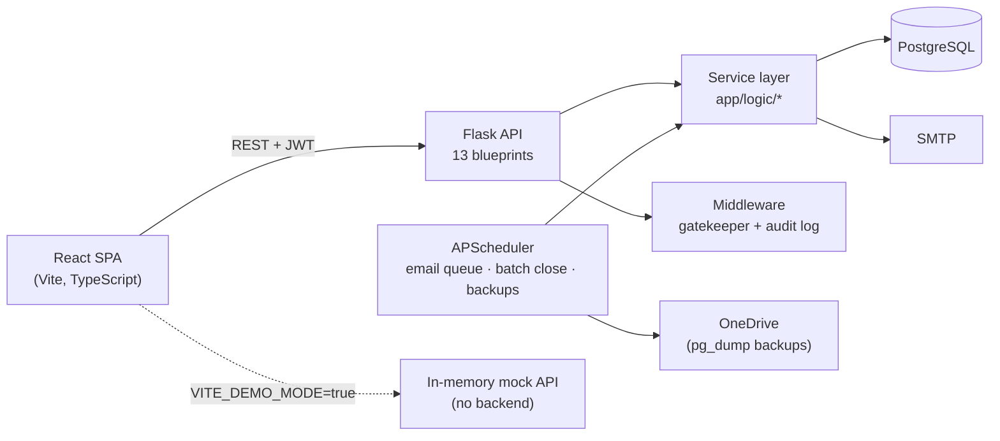

# OFSD — Fund Distribution & NAV Administration Platform

A Flask + PostgreSQL back office for pooled investment funds: onboard investors, run deposit batches through transfer and deployment, value holdings by NAV per share, process withdrawals and redemptions, and issue statements — with an audit trail on every change.

> **Live demo:** _add your Vercel URL here_ &nbsp;·&nbsp; click **Try Demo** on the login page (no account needed).
> The demo is the React frontend running on **mock data** — see [About the live demo](#about-the-live-demo).

<!-- Add a screenshot or GIF:  -->

## Features

- **Batch lifecycle** — pending → transferred → deployed → closed, with stage gates, per-investor deployment dates and fee handling (entry fee, transaction cost, pro-rata allocation on oversubscription).
- **Two product models** — pooled *Funds* and share-based *Shares* products, each with share classes and multi-currency (USD / KES / NGN) support.
- **NAV valuation engine** — NAV-per-share valuation runs with dry-run preview, reconciliation against the administrator's total, immutable snapshots and per-batch history.
- **Investors & withdrawals** — investor directory, deposits, withdrawal approval workflow, unit-based redemptions with FIFO lots.
- **Statements & reports** — PDF investor statements (ReportLab), Excel/CSV exports, client- and daily-activity reports, bulk statement ZIPs.
- **Email queue** — manual-approval queue with throttled background sending, per-recipient logs and a safe `MAIL_SUPPRESS_SEND` default.
- **Bulk upload** — validated Excel import with column mapping and resumable background jobs.
- **Security & ops** — JWT auth with role-based access (user / admin / super admin), account approval gatekeeper, audit log of every mutating request, optional nightly `pg_dump` → OneDrive backups.

## Tech stack

**Backend:** Python 3.12 · Flask 3 · SQLAlchemy 2 · Alembic / Flask-Migrate · Flask-JWT-Extended · PostgreSQL · APScheduler · Flask-Mail · ReportLab · pandas / openpyxl · pytest · gunicorn · Docker

**Frontend:** React 19 · TypeScript · Vite · Tailwind CSS 4 · React Router 7 · axios · react-hook-form + zod · Recharts / Chart.js · Vitest + Testing Library

## Architecture



```
main.py                  app factory: config, CORS, JWT, blueprints, error handlers
config.py                env-driven Development / Testing / Production configs
app/<Domain>/route.py    HTTP layer (Admin, Batch, Funds, Investments, Valuation, Reports, ...)
app/logic/               business rules: NAV valuation, transfers, deployment, redemptions
app/middleware.py        account gatekeeper + audit trail
app/database/            SQLAlchemy db, idempotent startup schema sync
migrations/versions/     Alembic migrations 001–026
tests/                   pytest suite (PostgreSQL)
ofds-frontend/           React SPA (+ src/demo mock layer)
```

## API

**206 REST endpoints** under `/api/v1`, plus `GET /api/v1/health`. Every endpoint except login and registration requires a Bearer JWT (enforced by a test that hits every route anonymously). Errors are JSON: `{"status": <code>, "message": "..."}`.

Full reference: **[docs/API.md](docs/API.md)** (generated by `scripts/gen_api_docs.py`). Highlights:

| Method | Route | Description | Auth |
|---|---|---|---|
| POST | `/api/v1/login` | Obtain access + refresh tokens | – |
| POST | `/api/v1/users` | Register (account starts as *pending* until approved) | – |
| GET | `/api/v1/health` | Liveness + DB check | – |
| GET / POST | `/api/v1/batches` | List / create batches | JWT |
| PATCH | `/api/v1/batches/<id>` | Advance stage, edit batch | JWT |
| GET / POST | `/api/v1/funds`, `/api/v1/shares` | Funds and share products | JWT |
| GET | `/api/v1/investors` | Paginated investor directory | JWT |
| POST | `/api/v1/investors` | Create investor + first deposit | JWT |
| GET | `/api/v1/investors/<code>/overview` | Positions across batches | JWT |
| POST | `/api/v1/valuation/nav` | Commit a NAV valuation run | JWT |
| GET / POST | `/api/v1/withdrawals` | List / record withdrawals | JWT |
| PATCH | `/api/v1/withdrawals/<id>` | Approve or reject | JWT |
| GET | `/api/v1/emails/pending` | Emails awaiting approval | JWT |
| GET | `/api/v1/audit-logs` | Audit trail | JWT |
| GET | `/api/v1/stats/overview` | Dashboard totals | JWT |

## Local setup

Prerequisites: Python 3.12+, Node 20+, PostgreSQL 14+ (or Docker).

### Backend

```bash
python -m venv venv && source venv/bin/activate      # Windows: venv\Scripts\activate
pip install -r requirements-dev.txt

cp .env.example .env            # then edit SECRET_KEY, DATABASE_URI, ...
docker compose up -d db         # optional: Postgres 16 with ofsd + ofsd_test databases
python scripts/create_super.py  # create the first super-admin (see script for options)
python main.py                  # http://127.0.0.1:4455
```

Key environment variables (full list in [`.env.example`](.env.example)):

| Variable | Purpose |
|---|---|
| `APP_ENV` | `development` (default), `testing`, `production` |
| `SECRET_KEY` | JWT signing key — **required** (≥ 32 chars) in production |
| `DATABASE_URI` / `TEST_DATABASE_URI` | PostgreSQL URLs |
| `CORS_ORIGINS` | Comma-separated allowed frontend origins |
| `MAIL_*`, `MAIL_SUPPRESS_SEND` | SMTP settings; sending is suppressed by default |
| `DB_BACKUP_ENABLED`, `AZURE_*` | Optional nightly backups to OneDrive |

Schema: tables are created on startup; `flask db upgrade` applies the Alembic migrations in `migrations/`.

### Tests

```bash
docker compose up -d db                   # or point TEST_DATABASE_URI at any empty Postgres DB
pytest --cov=app --cov-report=term-missing
```

### Frontend

```bash
cd ofds-frontend
npm ci
echo "VITE_API_URL=http://localhost:4455/api/v1" > .env.local
npm run dev            # real backend, http://localhost:5173
npm run dev:demo       # mock data, no backend needed
npm test               # Vitest
```

## About the live demo

The hosted demo is the **frontend only**, built with `VITE_DEMO_MODE=true`. In that mode the axios client is swapped for an in-memory mock API (`ofds-frontend/src/demo/`): all data is fictional (invented funds, "Demo Investor NNN", `example.com` addresses), create / edit / delete update state for the session, and everything resets on reload. A banner states this. Some secondary screens (bulk upload, valuation wizard, report/statement downloads) return empty or placeholder results in demo mode.

**The real Flask backend is not hosted** — it runs locally against PostgreSQL as described above. With `VITE_DEMO_MODE` unset, the frontend talks to the real API exactly as before.

### Deploying the demo (Vercel)

1. Push the repo to GitHub and import it at vercel.com/new.
2. Set **Root Directory** to `ofds-frontend`. Everything else comes from `ofds-frontend/vercel.json` (build `npm run build:demo`, SPA rewrite).
3. Deploy, then paste the URL into the *Live demo* line above.

## Author

**Daniel Mungai** — backend developer (Python / Flask)
GitHub: [github.com/mungaiDaniel](https://github.com/mungaiDaniel) · LinkedIn: [linkedin.com/in/daniel-mungai-7a52451b8](https://www.linkedin.com/in/daniel-mungai-7a52451b8)

Further design notes live in [`docs/notes/`](docs/notes/).
